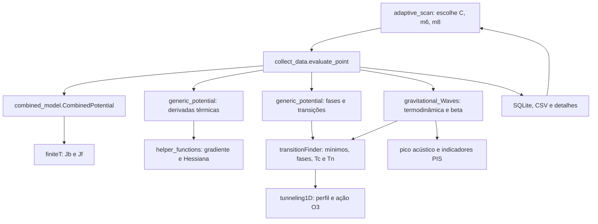

# Mapa do núcleo e relação com o artigo

Esta revisão mantém os sete módulos Python de `src/CosmoTransitions` intactos.
O inventário ao final registra as funções e os métodos encontrados nessa branch;
nomes iniciados por underscore são interfaces internas e exigem atenção quando
o núcleo mudar. O artigo reutiliza o fluxo existente em vez de duplicá-lo.

## Fluxo efetivamente usado

`__init__.py` reúne reexports dos módulos. Ele não é outro solucionador.
`finiteT.py` implementa integrais exatas, expansões nos regimes de massa e
splines com cache. O modelo do artigo usa `Jb/Jf(approx="spline")`, cujo
argumento é m²/T²; esse detalhe difere das interfaces em m/T de outras
aproximações. As massas escalares negativas seguem a continuação real existente.

`helper_functions.py` fornece pesos de diferenças finitas, derivadas sobre
malhas, gradiente/Hessiana, interpoladores e o passo adaptativo Cash–Karp.
`gradientFunction`/`hessianFunction` dão as derivadas de campo do potencial;
`fd_weights_1d` também é usado na derivada térmica da ação. `rkqs` integra o
perfil radial em `tunneling1D`.

`generic_potential.py` adapta V(phi,T) para X[...,0], constrói derivadas em
campo e temperatura e coordena a sequência de fases. As derivadas usam um
offset de V em X_ref para reduzir cancelamento; diferenças entre fases são
preservadas. `_build_phases_and_transitions` procura sementes, chama
`traceMultiMin`, remove fases redundantes, escolhe a fase inicial e calcula
transições críticas e o histórico de resfriamento com nucleação. Os demais
helpers organizam perfis, spinodais, diagnósticos e arquivos de exemplos.

`transitionFinder.py` é o coordenador físico de mínimos, fases e transições:
`traceMinimum` segue um mínimo com T; `Phase.valAt` interpola sua trajetória;
`traceMultiMin` encontra/conecta outras fases. `findCriticalTemperatures`
procura degenerescências de energia livre. `findAllTransitions` segue o
histórico desde a fase de alta T, chamando `tunnelFromPhase`; este avalia a
raiz do critério fornecido via `_tunnelFromPhaseAtT` e `_solve_bounce`.
O artigo fornece `NucleationCriterion`, com a tolerância em S3/T-140.

`_solve_bounce` procura o backend de múltiplos campos e, na ausência dele,
usa `SingleFieldInstanton` para um campo. Esta branch tem o backend 1D;
o fallback não autoriza modelos com mais de um campo. `PotentialError`
distingue ausência de barreira e vácuo estável de outras falhas.

`tunneling1D.py` encontra barreira/escala radial, condições iniciais e o perfil
por overshoot/undershoot, usando integração adaptativa. `findAction` integra
a ação do perfil; `actionBreakdown` e `wallDiagnostics` fornecem verificações
adicionais. O artigo não reimplementa a equação radial nem a ação.

`gravitational_Waves.py` refina mínimos de fase, verifica seu intervalo térmico
comum e calcula S3(T) pelo mesmo backend, guardando cache de ações. Sua
termodinâmica preserva as convenções assinadas alpha_energy e alpha_trace.
`beta_over_H(..., order=2)` usa duas ações em Tn±h; `order=4` continua disponível
no núcleo. Funções de espectro sem estado permitem reconstruir GW dos dados
salvos. A interface espectral usa mHz; o coletor exporta frequências em Hz.
As funções PIS fornecem indicadores sob suas hipóteses, não um SNR total.

## Relação com thesis_gw_results.py

O script em `docs/Thesis/Thesis_Main_Code` define `EFT68Parameters`, as parcelas
de V e as funções `run_00` a `run_08`, junto com muitos diagnósticos e gráficos.
`run_06_combined_C_scan` e `run_07_combined_c6_scan` percorrem C e o antigo
coeficiente, usando o mesmo pipeline de fases/bounce/GW. No artigo,
`ModelParameters` usa m6/m8 em GeV, `CombinedPotential` reúne a física e
`collect_data` salva os resultados sem importar nem executar aquele script.
A camada adaptativa substitui somente a escolha das coordenadas.

As normalizações preservadas são phi^6/(8 m6²), phi^8/(16 m8^4), matching
em v=246 GeV e mh=125 GeV, medida subtraída localmente, CW/contratermos e
ressoma gauge simplificada fixa da tese. O inventário abaixo não é uma nova
API pública nem uma promessa de estabilidade dos helpers internos.

## Inventário da branch inspecionada

### __init__.py

Reexports: funções térmicas, auxiliares, bounce, fases, GW e adaptadores.

### finiteT.py

- `_asarray`
- `_is_scalar`
- `_apply_elementwise`
- `_Jf_exact_scalar`
- `_Jb_exact_scalar`
- `_Jf_exact2_scalar`
- `_Jb_exact2_scalar`
- `_dJf_exact_scalar`
- `_dJb_exact_scalar`
- `Jf_exact`
- `Jf_exact2`
- `Jb_exact`
- `Jb_exact2`
- `dJf_exact`
- `dJb_exact`
- `_build_Jf_dataset`
- `_save_Jf_cache`
- `_load_Jf_cache`
- `_ensure_Jf_spline`
- `Jf_spline`
- `_build_Jb_dataset`
- `_save_Jb_cache`
- `_load_Jb_cache`
- `_ensure_Jb_spline`
- `Jb_spline`
- `_series_tail_sum`
- `Jb_low`
- `Jf_low`
- `x2K2`
- `dx2K2`
- `d2x2K2`
- `d3x2K2`
- `_select_K`
- `Jb_high`
- `Jf_high`
- `Jb`
- `Jf`

### generic_potential.py

- `PotentialDerivatives`
- `scalar_to_vector_potential_1d`
- `build_finite_T_derivatives`
- `ensure_dir`
- `savefig`
- `tee_stdout`
- `build_phi_grid`
- `_extract_params_from_V`
- `_build_phases_and_transitions`
- `_spinodal_data_for_phase`
- `_closest_spinodal_to_T`
- `_build_gw_calculator_from_summary`
- `_compute_gw_scales_from_calculator`
- `compute_profile`
- `gather_diagnostics`
- `save_diagnostics_summary`

### gravitational_Waves.py

- `GravitationalWaveCalculator`: `__init__`, `_common_temperature_range`, `_check_temperature_inside_range`, `_minima_at_T`, `_S3_at_T`, `dS_dT`, `beta_over_H`, `thermodynamics`, `alpha`, `_f_sw_peak`, `omega_sw_h2`, `_h_star_Hz`, `_f_turb_peak`, `omega_turb_h2`, `_f_coll_peak`, `omega_coll_h2`, `omega_total_h2`, `nucleation_rate`, `bubble_radius_over_H`
- `gw_f_sw_peak`
- `gw_omega_sw_h2`
- `gw_h_star_Hz`
- `gw_f_turb_peak`
- `gw_omega_turb_h2`
- `gw_f_coll_peak`
- `gw_omega_coll_h2`
- `gw_omega_total_h2`
- `_pisc_poly_sum`
- `lisa_sensitivity_s_pis`
- `decigo_sensitivity_s_pis`
- `bbo_sensitivity_s_pis`

### helper_functions.py

- `set_default_args`
- `monotonic_indices`
- `clamp_val`
- `_rkck`
- `IntegrationError`
- `rkqs`
- `fd_weights_1d`
- `_stencil_indices`
- `deriv14`
- `deriv14_const_dx`
- `deriv23`
- `deriv23_const_dx`
- `deriv1n`
- `gradientFunction`: `__init__`, `__call__`
- `hessianFunction`: `__init__`, `__call__`
- `makeInterpFuncs`
- `cubicInterpFunction`: `__init__`, `__call__`
- `_safe_div`
- `Nbspl`
- `Nbspld1`
- `Nbspld2`

### transitionFinder.py

- `_traceMinimum_rval`
- `traceMinimum`
- `Phase`: `__init__`, `valAt`, `addLinkFrom`, `__repr__`
- `traceMultiMin`
- `findApproxLocalMin`
- `_removeRedundantPhase`
- `removeRedundantPhases`
- `getStartPhase`
- `_solve_bounce`
- `_tunnelFromPhaseAtT`
- `_potentialDiffForPhase`
- `_maxTCritForPhase`
- `tunnelFromPhase`
- `secondOrderTrans`
- `findAllTransitions`
- `findCriticalTemperatures`
- `addCritTempsForFullTransitions`

### tunneling1D.py

- `PotentialError`
- `SingleFieldInstanton`: `__init__`, `dV`, `dV_from_absMin`, `d2V`, `findBarrierLocation`, `findRScale`, `exactSolution`, `initialConditions`, `_normalize_tolerances`, `equationOfMotion`, `integrateProfile`, `integrateAndSaveProfile`, `findProfile`, `findAction`, `evenlySpacedPhi`, `actionBreakdown`, `wallDiagnostics`, `betaEff`

Inventário: 143 funções/métodos definidos no escopo dos módulos e classes; funções locais aninhadas permanecem detalhes internos das rotinas listadas.
